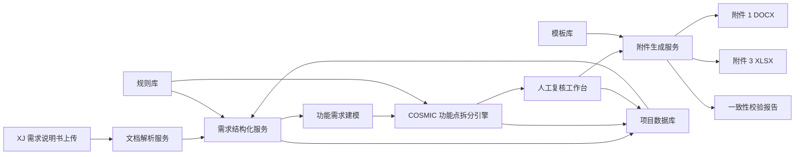
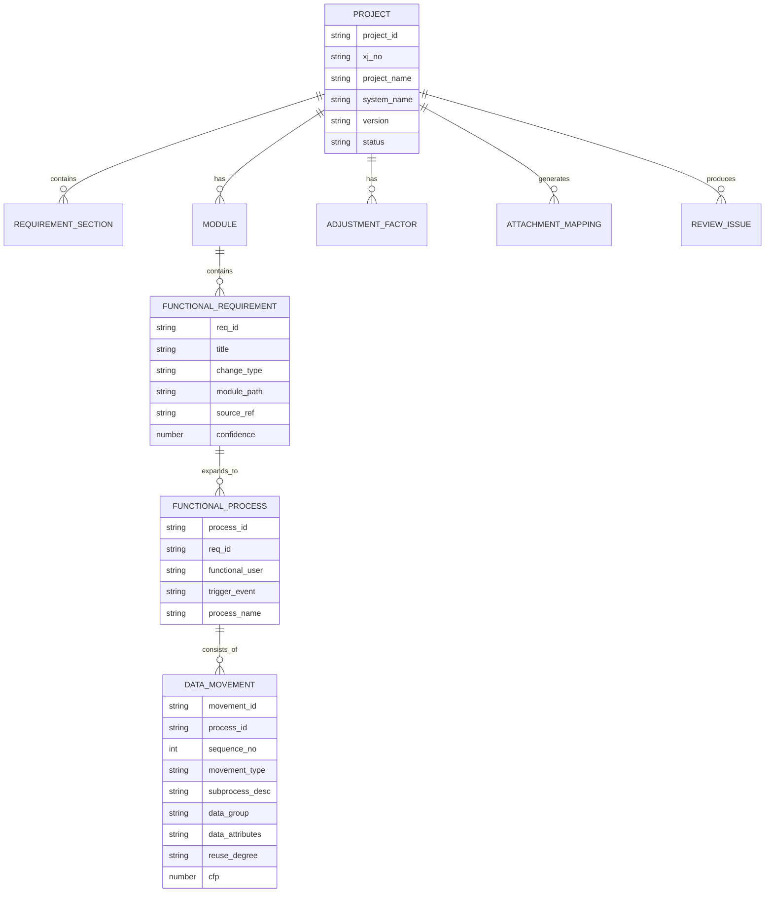
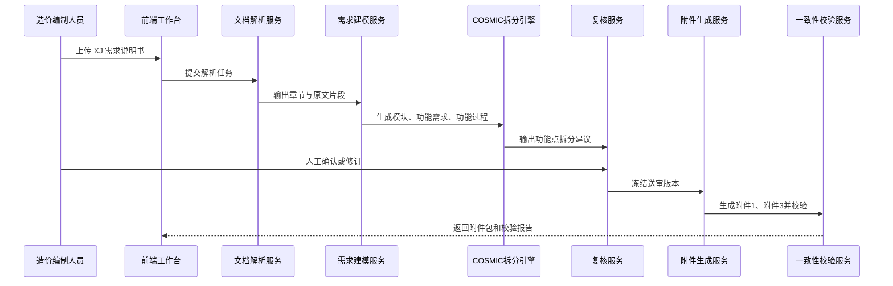

# COSMIC 软件造价附件自动生成系统架构设计

## 1. 建设目标

本系统面向软件公司内部结算送审场景，以甲方提供或认可的 COSMIC 软件造价评估模板为标准，自动从 `XJ-*.docx` 需求说明文件中提取需求信息，辅助完成功能点拆分，并生成一一对应的：

- 附件 1：项目需求说明书 `.docx`
- 附件 3：功能点拆分表 `.xlsx`

系统核心目标不是替代评审人员，而是把“需求文本 -> 附件 1 -> 附件 3”的转换过程标准化、可追溯、可复核，减少人工整理、漏项、附件不一致和公式填错的问题。

## 2. 样例模板识别结果

### 2.1 输入文件

当前样例输入为 `XJ-091-250905-00002-关于集客一线直通车新增通知公告功能模块的需求说明.docx`，主要结构包括：

- 背景及目标
- 归属系统
- 需求细则
- 具体功能点描述，如公告发布、公告修改、公告删除、公告废止、公告追加、定向发布、APP 推送、短信通知、审核配置等

### 2.2 附件 1 输出结构

附件 1 是需求说明书模板，关键章节包括：

- 1.1 总体描述
- 1.2 建设目标
- 1.3 建设必要性
- 2. 系统现状
- 3. 功能架构图
- 4. 功能需求
- 6. 附加值调整因子说明

其中第 4 章的功能需求是附件 3 功能点拆分的主要业务来源。

### 2.3 附件 3 输出结构

附件 3 包含 4 个工作表：

- 模型说明
- 1、环境图
- 2、功能点拆分表
- 3、附加值调整

其中：

- `1、环境图` 中建设目标对应附件 1 第 1.2 节。
- `1、环境图` 中建设必要性对应附件 1 第 1.3 节。
- `1、环境图` 中功能架构图对应附件 1 第 3 章。
- `2、功能点拆分表` 的 A 到 M 列是核心填报区，不应新增列。
- `2、功能点拆分表` 中 M 列 CFP 由 L 列复用度自动计算：新增为 1，复用为 1/3，利旧为 0。

## 3. 总体架构

系统采用“解析、建模、拆分、复核、生成、校验”六段式架构。附件 1 和附件 3 不分别手工生成，而是由同一套结构化需求模型统一渲染，保证二者天然同源。

## 4. 分层设计

### 4.1 接入层

提供 Web 页面或内网桌面化入口，支持：

- 上传 `XJ-*.docx` 文件。
- 选择附件 1、附件 3 模板版本。
- 查看解析结果、功能需求拆分结果和校验问题。
- 导出送审附件包。

### 4.2 文档解析层

负责从 XJ 需求说明中提取原始信息：

- 文件名解析：提取 XJ 编号、项目名称、需求标题。
- 段落解析：识别背景、目标、归属系统、需求细则。
- 结构识别：兼容不同写法，如“背景及目标”“建设目标”“需求背景”。
- 原文定位：每一条结构化数据保留来源段落，便于复核追溯。

### 4.3 需求建模层

将自然语言需求转换为统一业务对象：

- 项目
- 系统
- 一级模块
- 二级模块
- 三级模块
- 功能性用户需求
- 功能过程
- 子过程
- 数据组
- 数据属性
- 非功能需求
- 附加值调整因子

该层是附件 1 和附件 3 一一对应的基础。

### 4.4 COSMIC 拆分引擎

负责生成功能点拆分建议：

- 识别功能性用户，如操作员、审核人员、公告接收人、APP 端、短信平台等。
- 识别触发事件，如点击发布、提交审核、审核通过、公告修改、公告废止等。
- 拆分功能过程。
- 生成子过程描述。
- 判定数据移动类型：E 输入、X 输出、R 读、W 写。
- 生成数据组和数据属性。
- 判定复用度：新增、复用、利旧。
- 计算或保留模板公式计算 CFP。

引擎输出必须带置信度，低置信度项进入人工复核。

### 4.5 人工复核工作台

人工复核是系统的必要环节，主要处理：

- 功能需求是否漏拆或多拆。
- 模块层级是否符合历史项目口径。
- 数据移动类型是否符合 COSMIC 规则。
- 数据属性是否达到评审要求。
- 附加值调整因子是否有依据。
- 附件 1 描述与附件 3 拆分是否一致。

复核完成后冻结一个可导出的送审版本。

### 4.6 模板生成层

根据冻结后的结构化模型渲染两个附件：

- DOCX 渲染器：填充附件 1 的章节、功能清单、功能需求描述和调整因子说明。
- XLSX 渲染器：填充附件 3 的环境图、功能点拆分表和附加值调整页。
- 公式保护：复制 M 列 CFP 公式，保留附件 3 原有公式和下拉校验。
- 模板保护：不修改附件 3 的 A 到 M 列结构，不破坏原有格式和参数区。

### 4.7 一致性校验层

导出前执行强制校验：

- 附件 1 第 1.2 节与附件 3 环境图“建设目标”一致。
- 附件 1 第 1.3 节与附件 3 环境图“建设必要性”一致。
- 附件 1 第 3 章功能架构图与附件 3 环境图功能架构说明一致。
- 附件 1 功能清单中的功能需求，与附件 3 功能点拆分表中的功能过程可回溯到同一需求实体。
- 附件 3 每个功能过程至少包含 2 个子过程。
- 每个功能过程第一个数据移动建议为 E，最后一个数据移动建议为 W 或 X。
- 数据移动类型只能是 E、X、R、W。
- 复用度只能是新增、复用、利旧。
- M 列 CFP 公式完整。
- 附件 1 第 6 章调整因子说明与附件 3 附加值调整页选项一致。

## 5. 一一对应设计

系统内部使用“需求实体 ID”作为主线，但不强制在正式附件 3 中新增列，避免破坏甲方模板。

### 5.1 内部映射主键

每个功能性用户需求生成稳定 ID：

- `REQ-001`：通知公告发布
- `REQ-002`：通知公告修改
- `REQ-003`：通知公告删除
- `REQ-004`：通知公告废止
- `REQ-005`：通知公告追加
- `REQ-006`：定向发布
- `REQ-007`：公告审核
- `REQ-008`：APP 消息查看与已读未读状态

该 ID 存在系统数据库和校验报告中，不写入附件 3 固定 A 到 M 列。

### 5.2 附件 1 映射

附件 1 中每个功能需求章节和功能清单行都绑定一个 `REQ-ID`：

| 内部对象 | 附件 1 位置 | 映射字段 |
| --- | --- | --- |
| Project | 封面、1.1 | 项目名称、系统名称、总体描述 |
| Goal | 1.2 | 建设目标 |
| Necessity | 1.3 | 建设必要性 |
| ModuleTree | 3 | 功能架构图 |
| FunctionalRequirement | 4、功能清单 | 功能需求名称、一级模块、二级模块、三级模块 |
| FunctionalProcess | 4.x 详细描述 | 时序、流程、输入输出、规则 |
| AdjustmentFactor | 6 | 阶段、应用类型、质量特性、语言、团队背景、完整性级别 |

### 5.3 附件 3 映射

附件 3 中每个功能过程展开为多行数据移动：

| 内部对象 | 附件 3 位置 | 映射字段 |
| --- | --- | --- |
| Goal | 1、环境图 | 建设目标 |
| Necessity | 1、环境图 | 建设必要性 |
| ModuleTree | 1、环境图 | 功能架构图 |
| Project | 2、功能点拆分表 A 列 | 客户需求 |
| Module | 2、功能点拆分表 B/C/D 列 | 一级、二级、三级模块 |
| FunctionalUser | 2、功能点拆分表 E 列 | 功能用户 |
| TriggerEvent | 2、功能点拆分表 F 列 | 触发事件 |
| FunctionalProcess | 2、功能点拆分表 G 列 | 功能过程 |
| DataMovement | 2、功能点拆分表 H/I/J/K/L/M 列 | 子过程、数据移动、数据组、数据属性、复用度、CFP |
| AdjustmentFactor | 3、附加值调整 | C 列选项和 D 列计算结果 |

### 5.4 对应关系规则

附件 1 和附件 3 的对应关系不是简单的一行对一行，而是：

- 附件 1 的一个功能需求，可以对应附件 3 的一个或多个功能过程。
- 附件 3 的一个功能过程，必须来源于附件 1 的一个功能需求。
- 附件 3 的一个功能过程，可以展开为多个数据移动行。
- 附件 3 的每一行数据移动，都必须能回溯到附件 1 的功能需求章节。

导出时系统同时生成内部校验报告，报告中展示 `REQ-ID -> 附件 1 章节 -> 附件 3 行号` 的对应关系。

## 6. 核心数据模型

## 7. 关键业务流程

## 8. 功能模块设计

### 8.1 项目管理

- 新建项目
- 上传 XJ 文件
- 维护项目名称、系统名称、需求编号
- 管理不同送审版本
- 查看导出历史

### 8.2 XJ 文档解析

- 自动识别 XJ 编号和需求标题。
- 自动提取背景、目标、系统、需求细则。
- 支持解析失败时人工标注章节。
- 保留原文引用，供附件内容追溯。

### 8.3 功能架构建模

- 生成一级、二级、三级模块树。
- 标记模块类型：新增、优化、删除、已有。
- 支持人工拖拽调整模块层级。
- 自动同步到附件 1 第 3 章和附件 3 环境图。

### 8.4 功能需求工作台

- 以功能需求为中心维护名称、模块、变更类型、描述。
- 维护关键时序、输入输出、状态规则、约束条件。
- 生成附件 1 第 4 章内容。

### 8.5 功能点拆分工作台

- 按功能需求展示功能过程。
- 按功能过程维护 E/X/R/W 子过程。
- 支持从模板快速生成常见 CRUD、审核、通知、查询类拆分。
- 自动复制复用度和 CFP 公式。
- 对低置信度、规则冲突和信息不足项进行提示。

### 8.6 附加值调整

- 阶段类别：事前评审、事后评审。
- 应用类型：业务处理、科技、多媒体、智能信息、基础软件/支撑软件、通信控制。
- 质量及特性：分布式处理、性能、可靠性、多重站点。
- 开发语言。
- 开发团队背景。
- 完整性级别。

附件 1 第 6 章的文字说明与附件 3 第 3 页的选项必须由同一数据源生成。

### 8.7 附件生成

- 基于模板生成附件 1 DOCX。
- 基于模板生成附件 3 XLSX。
- 保留模板原有格式、公式、下拉框和说明区。
- 输出前自动清理模板中的红色说明文字和蓝色示例文字。
- 生成文件命名建议：`附件1-项目名称-需求说明书Vx.x.docx`、`附件3-项目名称-功能点拆分表Vx.x.xlsx`。

### 8.8 校验与审计

- 一致性校验。
- COSMIC 规则校验。
- 模板结构校验。
- 必填项校验。
- 公式完整性校验。
- 导出版本审计。

## 9. 技术架构建议

### 9.1 部署形态

建议采用内网 Web 应用部署：

- 前端：Vue / React
- 后端 API：Java Spring Boot 或 Python FastAPI
- 异步任务：Redis Queue / Celery / Spring Batch
- 数据库：PostgreSQL / MySQL
- 文件存储：MinIO / NAS
- 文档处理：LibreOffice Headless、python-docx、openpyxl 或企业内部 Office 组件
- 权限认证：企业 SSO / LDAP / OAuth2

如团队规模较小，也可先做本地工具版，后续再演进为内网平台。

### 9.2 服务划分

| 服务 | 职责 |
| --- | --- |
| project-service | 项目、版本、人员权限 |
| parser-service | XJ 文档解析、章节识别 |
| modeling-service | 需求结构化、模块树、功能需求 |
| cosmic-service | COSMIC 功能点拆分、规则校验 |
| template-service | 附件 1、附件 3 模板渲染 |
| validation-service | 一致性校验、公式校验、送审检查 |
| file-service | 原始文件、生成文件、模板文件管理 |
| audit-service | 操作记录、版本差异、导出记录 |

## 10. 样例需求的初步拆分方向

针对“集客一线直通车新增通知公告功能模块”，可初步建模为：

| 功能需求 | 一级模块 | 二级模块 | 功能过程示例 |
| --- | --- | --- | --- |
| 通知公告发布 | 集客一线直通车 | 通知公告 | 发布公告 |
| 通知公告修改 | 集客一线直通车 | 通知公告 | 修改公告 |
| 通知公告删除 | 集客一线直通车 | 通知公告 | 删除公告 |
| 通知公告废止 | 集客一线直通车 | 通知公告 | 废止公告 |
| 通知公告追加 | 集客一线直通车 | 通知公告 | 追加公告内容 |
| 定向发布 | 集客一线直通车 | 通知公告 | 选择人员、角色、区域并发布 |
| 公告审核 | 集客一线直通车 | 通知公告 | 提交审核、审核通过、审核驳回 |
| 公告接收与状态 | 集客一线直通车 | 通知公告 | APP 查看消息、更新已读未读状态 |

例如“发布公告”可拆成：

| 数据移动 | 子过程描述 | 数据组 | 数据属性 |
| --- | --- | --- | --- |
| E | 接收公告发布信息 | 公告信息 | 标题、内容、通知类型、接收范围、发布人 |
| R | 读取通知类型和审核配置 | 配置信息 | 通知类型、审核角色、推送渠道 |
| W | 记录公告发布信息 | 公告记录 | 公告编号、标题、内容、状态、创建时间 |
| X | 向接收人发送 APP 和短信提醒 | 通知消息 | 接收人、消息标题、消息内容、发送渠道、发送状态 |

实际送审时需由复核人员确认拆分粒度，避免同一功能被重复计量。

## 11. 校验规则清单

### 11.1 附件一致性

- 附件 1 功能清单中的每一项，必须在附件 3 中存在对应功能过程。
- 附件 3 中出现的模块名称，必须存在于附件 1 功能架构图或功能清单。
- 附件 1 的功能需求名称变更后，附件 3 对应行必须同步变更。
- 附件 3 的客户需求字段必须与项目名称或正式需求名称一致。

### 11.2 COSMIC 合规性

- 每个功能过程必须有唯一触发事件。
- 每个功能过程建议至少包含一个 E。
- 每个功能过程建议以 W 或 X 结束。
- 数据移动类型只能取 E、X、R、W。
- 数据组不能为空。
- 数据属性建议不少于 3 个。
- 复用度只能取新增、复用、利旧。

### 11.3 模板合规性

- 附件 3 不新增 A 到 M 列之间的列。
- M 列公式必须完整复制到所有数据移动行。
- 附加值调整页的下拉选项不得被破坏。
- 模型说明页和参数说明区不得被改写。
- 正式导出时移除模板示例和说明文字。

## 12. 权限与审计

| 角色 | 权限 |
| --- | --- |
| 编制人员 | 上传 XJ、编辑拆分、生成附件草稿 |
| 复核人员 | 审核功能点拆分、确认调整因子、冻结版本 |
| 管理员 | 维护模板、规则库、用户权限 |
| 审计人员 | 查看历史版本、导出记录、操作日志 |

所有关键动作需要记录：

- 上传原始文件
- 自动解析结果
- 人工修改内容
- 复核确认记录
- 附件导出记录
- 校验报告

## 13. 实施路线

### 阶段一：MVP

- 支持上传 XJ DOCX。
- 自动抽取背景、目标、系统、需求细则。
- 人工维护功能需求和功能点拆分。
- 自动生成附件 1 和附件 3。
- 实现基础一致性校验。

### 阶段二：智能拆分增强

- 引入规则和模型辅助生成功能过程。
- 支持常见功能模板，如新增、修改、删除、审核、通知、查询、导入导出。
- 支持低置信度提示和人工修订闭环。

### 阶段三：评审资产沉淀

- 沉淀历史项目拆分样例。
- 形成系统级模块字典和功能点知识库。
- 支持同类需求复用拆分。
- 支持批量项目生成和送审包管理。

## 14. 关键风险与控制措施

| 风险 | 控制措施 |
| --- | --- |
| XJ 文件格式不统一 | 章节别名识别、人工标注、解析置信度 |
| 自动拆分不符合甲方口径 | 强制人工复核、历史样例库、规则库版本化 |
| 附件 1 和附件 3 不一致 | 同源数据模型生成、导出前一致性校验 |
| 破坏 Excel 模板公式 | 基于模板复制填充、公式完整性扫描 |
| 调整因子依据不足 | 附件 1 第 6 章与附件 3 选项强绑定 |
| 同一功能重复计量 | 需求实体 ID、功能过程去重、复核提示 |

## 15. 结论

本系统的架构核心是建立一个统一的“结构化需求模型”，让附件 1 和附件 3 都从同一份模型生成。系统不直接把 Word 文本硬塞进 Excel，而是先把需求拆成项目、模块、功能需求、功能过程和数据移动，再分别渲染到附件 1 和附件 3。这样才能保证一一对应、可解释、可复核，也更符合 COSMIC 软件造价评估的送审习惯。
